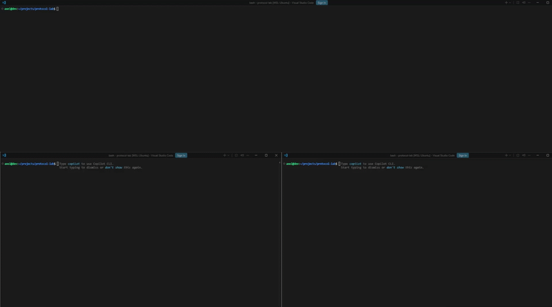
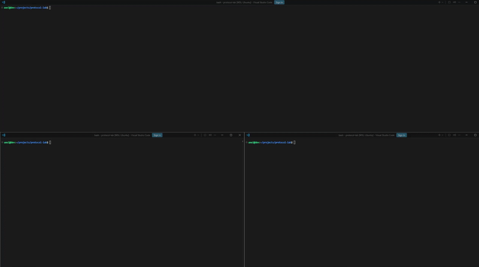
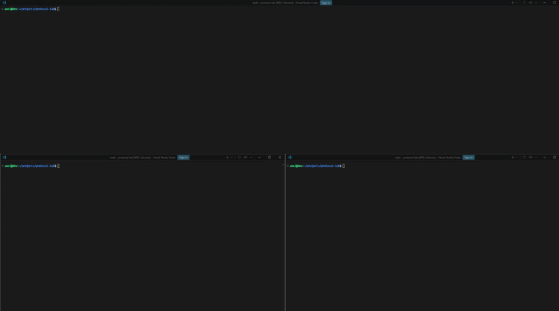
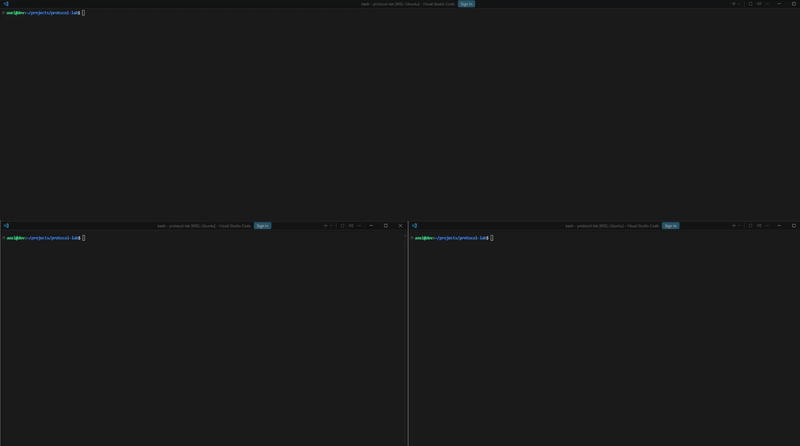
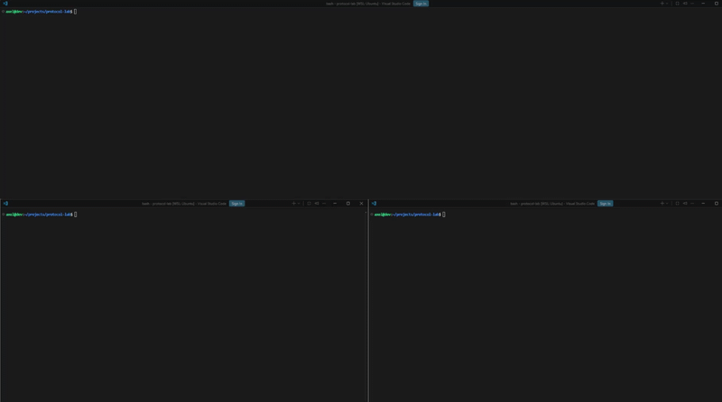

# TransportLab

## :book: Overview

Implementation of reliable data transfer protocols in C featuring error detection, retransmissions, flow control, Go-Back-N, and Selective Repeat mechanisms.

## :hammer_and_wrench: Skills Demonstrated

- C Programming
- Network Programming
- Network Protocol Design
- Algorithm Development
- Troubleshooting

## :rocket: Implemented Protocols and Demos

### v0 - Unreliable Transfer

Demonstrates basic data transmission without reliability guarantees, acknowledgements, or retransmissions.

### v1 - Stop-and-Wait with Error Detection

Introduces checksum-based corruption detection while maintaining a simple stop-and-wait communication model.

### v2 - Stop-and-Wait ARQ

Adds acknowledgements and retransmissions to ensure reliable delivery over an unreliable channel.

### v3 - Go-Back-N

Improves throughput through a sliding window mechanism and cumulative acknowledgements.

### v4 - Selective Repeat

Optimizes reliability and efficiency by selectively retransmitting only lost or corrupted packets.

## :raised_hands: Credits

Thank you for checking out my project!